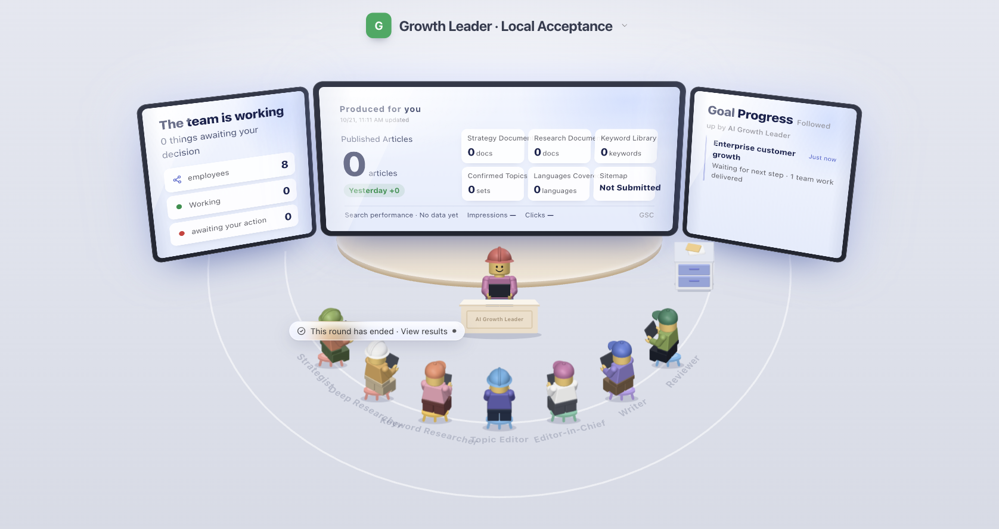

# GrowthHarness

A self-hosted AI content team that researches your business, plans SEO content, writes drafts, and brings articles to you for publishing approval.

Give the Growth Leader a goal, follow the team's work in the classroom, and review what it produces before anything goes live.



*The actual console running locally with sample data.*

- **Build shared business context.** Keep product facts and research available to the team.
- **Move from research to drafts.** Work through keyword research, topic selection, writing, and independent review.
- **Follow ongoing work.** Open a team member's task to inspect progress, deliverables, and blockers.
- **Keep publishing under your control.** Review articles and approve publication from the same workspace.

## Getting Started Locally

Requires Node **22.18+** and npm. The local Cloudflare development tools are installed by `npm ci`; you do not need to create cloud resources or deploy first.

```bash
git clone https://github.com/ahamoment-101/growth-harness.git
cd growth-harness
npm ci
npm run setup -- --local
npm run dev
```

`setup` prepares `.dev.vars`, generates initialization codes and signing keys, and applies local migrations without overwriting existing keys or model choices. Open the address output by the development server, and on the initialization page, enter your email, a password of at least 12 characters, and the `AUTH_SETUP_TOKEN` from `.dev.vars`. Once the administrator is established, initialization is closed.

After logging in, add a site and enter the classroom. Before running Agents, put `OPENROUTER_API_KEY` in `.dev.vars`; all default model choices and per-Agent reasoning live in [`shared/config/agent-models.json`](shared/config/agent-models.json). The preset uses GLM 5.3 Flash for planning/review and Gemini 3.8 Flash for writing, both through OpenRouter; no additional model key is needed. To use native OpenAI, Anthropic or a custom endpoint, see [model connections](docs/model-channel.md). Configure research, keyword data and GSC only when needed.

Set the key before sending your first task, then restart the development server:

```dotenv
# .dev.vars
OPENROUTER_API_KEY=replace-with-your-key
```

If the selected model key is missing, the console shows the required variable and setup instructions. Existing tasks pause without repeated model attempts and can resume after the configuration is restored.

### Local Runtime and Data

`npm run dev` starts the console and Worker on your machine using the Cloudflare Vite plugin and its local runtime (`workerd`/Miniflare). The commands above do not deploy a Worker to your Cloudflare account.

- **Database:** By default, D1 is backed by local SQLite files under `.wrangler/state/v3/d1/`. The local setup command applies the SQL files in `migrations/` to this database.
- **Other state:** Local R2 objects, Durable Object storage and Workflow state are also kept under `.wrangler/state/v3/`. Each checkout has its own local storage; isolated tests can use a separate persistence directory.
- **Local publishing:** Approved articles are served from the development server's address. They are not automatically published to a public Cloudflare URL.
- **External services:** Configured model and research APIs are still real network services. Running Agents with real credentials can incur provider charges.

Keep the development server running while Agents execute. Stopping it stops local execution but does not delete persisted data; deleting `.wrangler/` removes that local state. Both `.wrangler/` and `.dev.vars` are ignored by Git.

Cloudflare hosting uses separate resources and Secrets, configured through [self-hosting](docs/self-hosting.md#cloudflare). Local databases and stored articles are not automatically copied to production when you deploy. Verify the deployed installation separately; a local test does not establish production readiness.

## Optional DataForSEO keyword data

[DataForSEO](https://dataforseo.com/) is a paid API service that supplies SEO data. The Keyword Research Agent can use it to look up country-specific search volume, keyword difficulty, search intent, CPC and monthly search trends, or retrieve organic Google results and results-page features (SERP). These observations help the Agent compare demand and inspect competing pages; they do not guarantee rankings or traffic.

To enable these queries, set both `DATAFORSEO_LOGIN` and `DATAFORSEO_PASSWORD` using the API credentials from your [DataForSEO dashboard](https://app.dataforseo.com/). Put them in `.dev.vars` locally or Cloudflare Secrets in production, then restart or redeploy. Do not commit credentials. No separate feature flag is required. The Agent decides whether a query is useful; configuring credentials does not force a paid lookup on every task.

**Without DataForSEO**, keyword research retains its existing methods: autocomplete suggestions, existing library and business/research materials, web search through Firecrawl when configured, and Search Console data when connected. There is no automatic replacement service for measured search volume or difficulty. Unavailable metrics remain unknown, not zero, and missing DataForSEO credentials do not prevent the Agent from maintaining the library or returning its research outcome. Firecrawl, GSC and model services keep their own setup requirements.

Successful queries are saved by site, language and country with source, observation time and request cost. The Agent can read saved observations before deciding whether fresh data is needed. DataForSEO bills queries separately, including some failures and queries with no data. Interrupted requests with an unknown outcome are not automatically repeated. Existing running tasks keep their pinned tool contract; start a new keyword research task to use the newly added tools after upgrading.

## Configuration and Deployment

- [First-Run Verification](docs/launch-readiness.md): Missing-key recovery, presentation checks, and verification limits.
- [Configuration Guide](docs/configuration.md): Purpose, service portal, required conditions, costs, and impact of absence for each configuration item.
- [Self-Hosting and Upgrades](docs/self-hosting.md): Your own Cloudflare resources, Secrets, deployment, migration of existing Google users, and password resets.
- [Changelog](CHANGELOG.md): Released versions and the upgrade notes to read before each upgrade.
- [Verification Guide](docs/verification.md): Local checks and opt-in model/publication acceptance.
- [Documentation Index](docs/README.md): Shared architecture and feature contracts.

`wrangler.jsonc` stores deployment resources and public settings, using your own database ID and domain; `.dev.vars` is used only locally. Production keys are stored in Cloudflare Secrets. When enabled login methods lack required items, startup checks fail; disabled methods do not display buttons and their login endpoints cannot be invoked.

## Verification and Development

Follow the [local verification checklist](docs/verification.md#local-checks). Default checks use isolated resources and synthetic model responses without paid calls. Real-provider acceptance is opt-in; passing a build or fixture does not establish content quality or growth.

- Frontend `src/`; HTTP entry `worker/index.ts`.
- Authentication `worker/lib/auth/`; configuration `shared/config/`, `scripts/configuration.ts`.
- Agent missions and tools reside in corresponding domain directories; shared execution mechanisms reside in `worker/agent-runtime/`.
- Database upgrades reside in `migrations/`, executed sequentially.
- [Continuous Runtime Contract](docs/continuous-agent-runtime.md), [Cloudflare Architecture](docs/cloudflare-architecture.md), [Optional Webhook Export](docs/ingest-contract.md).

Publishing retains manual review; Webhook is an optional export method. Do not commit passwords, model Keys, or production business data.

## Current Scope

Each installation has one owner workspace. Email and password login is the default; Google login is optional and public registration is disabled. Model and research services use your own credentials and may incur provider charges.

The console and operational reports use English. Research and published articles use their independently configured target languages.

The shared Runtime preserves task identity and conversation history, handles execution recovery and tool permissions, and supports autonomous audits. Domain Agents choose business actions through their prompts and tools. Continuous execution and within-task feedback have been verified; cross-task learning and automatic Harness improvement remain roadmap work. SEO growth outcomes require separate measurement.

The React/Vite console and hosted articles run on Cloudflare Workers, with D1, R2, Durable Objects, and Workflows for storage and execution.

## License and Maintenance

The code is licensed under [MIT](LICENSE); third-party materials retain their [original license notices](THIRD_PARTY_NOTICES.md). Builds simultaneously generate browser and Worker dependency notices, shipping `THIRD_PARTY_LICENSES.txt` with the application. To participate in development, see [CONTRIBUTING](CONTRIBUTING.md); please report security issues privately per [SECURITY](SECURITY.md); standard issues can use repository Issue templates.

CI uses lockfiles to run tests, builds, empty database migrations, and local Workflow verification, while checking dependencies and Git history credentials without requiring production keys. Live paid acceptance is separated from CI.

Maintainers of a downstream distribution or public source export can use [repository maintenance](docs/repository-maintenance.md).
