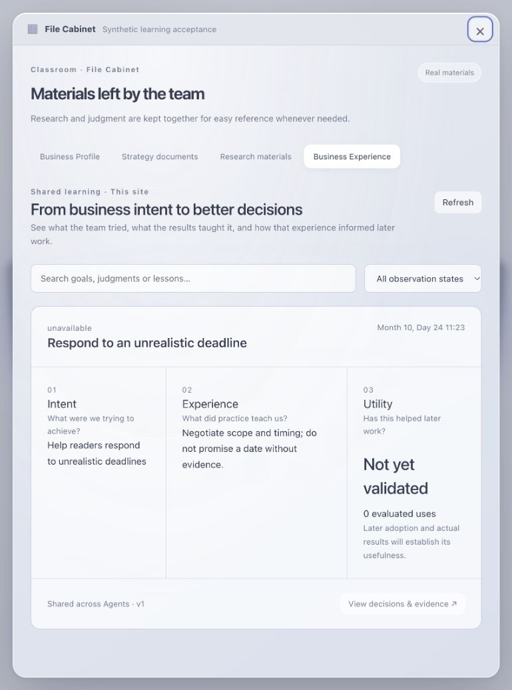

# Business learning acceptance

Public-source migration, 2026-10-24. This report concerns the public repository candidate; it is not a production deployment receipt or proof of SEO growth.

## Review scope

The source baseline was `b2a9f4c`. Learning-related shared files matched that baseline before migration. Only reviewed learning changes, migrations 0082–0084, public setup guidance, synthetic fixtures and verification scripts were extracted. Private model adapters, deployment bindings, credentials, customer material and historical operational reports were excluded.

Pre-implementation review identified two distribution risks: enabling remote bindings by default would break account-free local installation, and the previous acceptance launcher assumed a private provider. The public candidate leaves semantic bindings opt-in, uses the existing public model registry, and passes only selected model credentials into its isolated verification Worker. Cloudflare management credentials remain on the host.

Post-implementation review follows the user path from preparation through retrieval/read/adoption, delegation, formal delivery, delayed publication and outcome processing to later reuse. Shared Runtime changes are limited to registration, optional binding types and a domain-provided failure callback. Business choices remain in Leader/Learning definitions and semantic tools. Code enforces authorization, scope, observed versions, atomic receipts, durable effects and declared arithmetic. Search does not enforce a quality cutoff. Older task definitions stay pinned.

## Local verification

| Check | Observed result |
| --- | --- |
| Worker unit suite | 1,213 passed; 18 existing skipped tests. Covers learning calculations, isolation, atomic revisions, replay, recovery, legacy contracts, publication/outcomes and semantic indexing. |
| TypeScript and production build | Passed in the working checkout and an isolated source export with no environment files. The export installed its lockfile independently, passed the same unit suite. Existing large browser-chunk warning remains. |
| Public synchronization tests | Passed. Shared-core comparison with the source distribution reports zero changed files. |
| Fresh installation | All 84 D1 migrations apply; repeated setup preserves credentials/model configuration; password reset and deployment-placeholder guards pass. |
| Upgrade and offline learning API | Existing site survives migration from schema 0081; real local Worker/D1 verify atomic receipt replay, authenticated list/detail, cross-workspace denial, missing semantic configuration and unknown Utility. Zero external requests. |
| Authentication and model configuration | Real local Workflow missing-key pause, original task preservation, first-input atomicity, password setup, concurrent owner fencing, session revocation pass. |
| Browser | File Cabinet list/detail and refresh readback show Intent / Experience / Utility. Narrow viewport stacks them in that order without horizontal page overflow. Missing evaluation and unknown Utility are explicit. |
| Public boundary | Candidate source, all reachable history and production artifacts pass export checks. Gitleaks finds no credentials in candidate or history. |

The offline verifier passed in the working checkout. Its second invocation in the isolated export encountered an occupied preview port and was not rerun after the maintainer waived additional public acceptance.

The screenshot is a synthetic fixture. It has no real customer, publication or outcome data. Browser navigation was verified in Ego Lite; its screenshot endpoint timed out, so the in-app browser was used for the captured image and narrow viewport inspection.

## Real external retrieval

The public source ran a local Worker/D1 against real Cloudflare Workers AI BGE-M3 and an isolated 1024-dimensional cosine Vectorize index. The harness bridges binding calls to the real REST APIs; this run does not independently certify a deployed Worker's native bindings.

- Corpus: 28 synthetic site experiences plus two same-content records in foreign site/workspace scopes.
- Eight predefined relevance cases, including English, Chinese and Portuguese paraphrases: expected record ranked first in all eight.
- Included an older record outside the first directory page, a failed lesson, an unknown-Utility record and a high-Utility distractor.
- No foreign-scope record was returned.
- A Utility-only change appeared in hydrated results without a new embedding/upsert.
- A content revision immediately excluded the stale generation and became searchable after asynchronous index confirmation.

This is a small controlled relevance benchmark, not an estimate of accuracy on arbitrary business history. Indexing can take minutes to become visible; confirmation is part of the measured lifecycle.

The first attempt encountered local DNS failure after the relevance checks. It also could not confirm temporary-index deletion. The existing remote index was read back before resuming; completed evidence was retained. The temporary test index was subsequently deleted, with HTTP 410 (`vectorize.index.deleted`) readback confirming cleanup. The launcher now preserves the original verification error if cleanup also fails and prints the retained index name for reconciliation.

## Model and growth limits

The configured public OpenRouter model was `z-ai/glm-5.3-flash`. The real endpoint returned HTTP 401, `API key expired`. Consequently this public-source run does **not** establish a successful real Leader adoption decision or a newly generated Learning Agent record. Previous private-provider acceptance is not substituted for this missing evidence. Further public-model acceptance was explicitly waived by the maintainer for this migration, relying on prior private-distribution acceptance and unchanged shared behavior. This waiver is not recorded as a successful public-provider call. The opt-in test remains available for future installations.

No real article was published, no production D1 migration or Worker deployment occurred, and no real Google outcome was collected during this migration. Tests use synthetic business/outcome evidence. Functional correctness, retrieval relevance and measured growth remain separate claims.

## Reproduce

Use the commands in [Business learning](business-learning.md#console-and-verification). The real test is opt-in and uses isolated resources; its reports are stored in ignored `.wrangler/` state. Do not commit model transcripts, cookies, environment files or account-specific index receipts. CI runs the offline path without external credentials.
