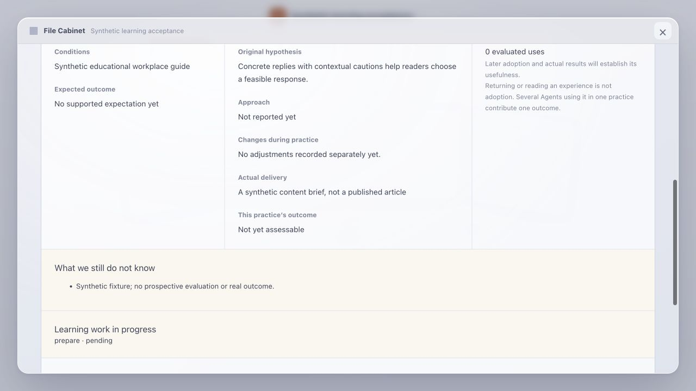

# Learning findings and adoption semantics

This report preserves the classification-specific experiments at their original contract versions. See the later [formal-outcome acceptance update](learning-outcome-evidence.md#production-acceptance-update) for the released end-to-end flow; it does not erase the semantic-classification limitations below.

## Problem and ownership

A business revision can be described only as a conclusion, leaving the separately rendered adjustments empty. Historical recommendations can also be passed into assignments without an adoption receipt when preparation prose confuses compatibility, recommendations and actual use. These are domain observation and output-contract gaps. Retrieval success alone cannot establish that the Leader read and adopted an experience, and a single missed receipt does not prove how often this happens.

The change belongs to the Learning Agent and Leader definitions, plus the cabinet presentation. It does not change Runtime execution, retrieval ranking, adoption persistence, attribution, utility arithmetic or observation scheduling.

## Contract

- Learning Agent definition 4 explains adjustment, delivery, conclusion and limitation in its instructions and the submission schema. An evidenced implemented change and its lesson may be separate findings citing the same evidence. Requested changes alone do not prove implementation. The complete finding set still replaces the previous set.
- Preparation recommends source record ids. Its history reads and evaluation compatibility checks cannot register the business Leader's adoption or supply the Leader's own observed reference.
- Leader definition 23 distinguishes recommendation, adoption and outcome validation. It reads a candidate itself, judges fit and registers an actual decision change through the existing tool. Unknown utility and failure lessons remain legitimate candidates. Rejection, further investigation and proceeding without adoption remain legitimate decisions.
- The cabinet empty state says “No adjustments recorded separately yet.” Empty structured adjustments do not prove that the business work never changed.

Classification, relevance and the decision to adopt remain model judgments. Existing deterministic reference validation, version checks, receipts and typed-field projection are unchanged. No keyword classifier, forced-adoption rule, retrospective receipt or utility update is introduced.

## Compatibility and review

New instructions are gated by persisted definition versions. The submission tool is version 4 for new Learning tasks; versions 1 and 3 retain their schemas. The new schema changes descriptions only, not its accepted decision space. Existing conversations and saved manifests remain pinned. Specialists, source data and frozen evaluation agreements are unaffected. A new request may consolidate old formal evidence, but must not manufacture an earlier adoption or a pre-action agreement.

Reviewed user paths: no history, recommendation without use, actual adoption of an unvalidated lesson, revision with a lesson, missing evidence, existing task continuation, and repeated submission. The call path remains domain instructions → existing Runtime → typed submission → persisted findings → cabinet projection. Tool errors remain visible to the same loop. The semantic instructions can evolve through future definition versions without changing orchestration.

## Verification scope

Tests cover new-definition gating, historical submission schemas, equivalent accepted schemas after removing descriptions, and saving adjustment/conclusion findings from shared evidence while preserving evaluation, utility and empty adoption records. Replaying the submission produces one revision.

A private isolated local replay uses existing formal business evidence, the configured real model and the normal Worker/D1/Workflow Runtime. Its customer receipts and model acceptance artifacts stay in the private ignored directory. The initial prompt-only experiment reached the model but still returned revisions only as conclusions; that result motivated adding semantics directly beside submission fields. This is a classification and presentation check, not a fresh business practice, production repair, or demonstration of growth uplift. A new production Leader's independent read/adopt behavior and mature external outcomes require separate acceptance.

### Results on 2026-10-25

- Public suite: 1,272 passed, 18 skipped. Private suite: 1,285 passed, 24 skipped. Both builds passed, including their configured-secret output checks. Upstream synchronization tests: 3 passed; downstream parity check: no differences. The downstream checkout deliberately has no independent `test:sync` script; the upstream sync test exercises destination behavior.
- Three isolated replays using the configured real model completed and preserved the frozen evaluation, unknown utility and zero adoption receipts. All three still retained implemented revisions only in conclusions. Serialized transport confirmed that both the new instructions and the new field descriptions reached the model. No success rate or autonomous correction claim follows from these runs. Historical source records referenced by the copied practice were not present locally; their reads reported unavailable instead of fabricating history.
- These results support the narrower statement that persistence and projection contracts work, while default semantic reclassification remains unreliable for this case. The empty-state correction is accurate independently of that limitation. Existing production data was not rewritten, and this change has not been deployed.
- A fourth isolated replay supplied the user's concrete feedback that revisions were present only in conclusions. It saved three adjustment findings tied to the two rejected versions and the final published version. The existing loop recovered from a missing field and an attribution mismatch before committing. Evaluation and utility stayed byte-equivalent as parsed values, and adoption remained empty. This demonstrates correction with explicit semantic feedback, not reliable unprompted classification. Production history remains untouched.
- Browser verification is incomplete for the final replay. The local console was opened, but a final rendered readback was not captured. A local fixture preview is available; build and API readbacks must not be described as completed browser acceptance.

### Publication UI check

The final public build was rendered using `LEARNING_PREVIEW=1 node scripts/verify-learning-offline.mjs`, with synthetic records and all external requests disabled. The detail view showed “No adjustments recorded separately yet.” and kept unknown outcomes and Utility unknown. This verifies the copy change, not autonomous classification. The fixture's pending preparation is deliberately unprocessed because no model is called.

